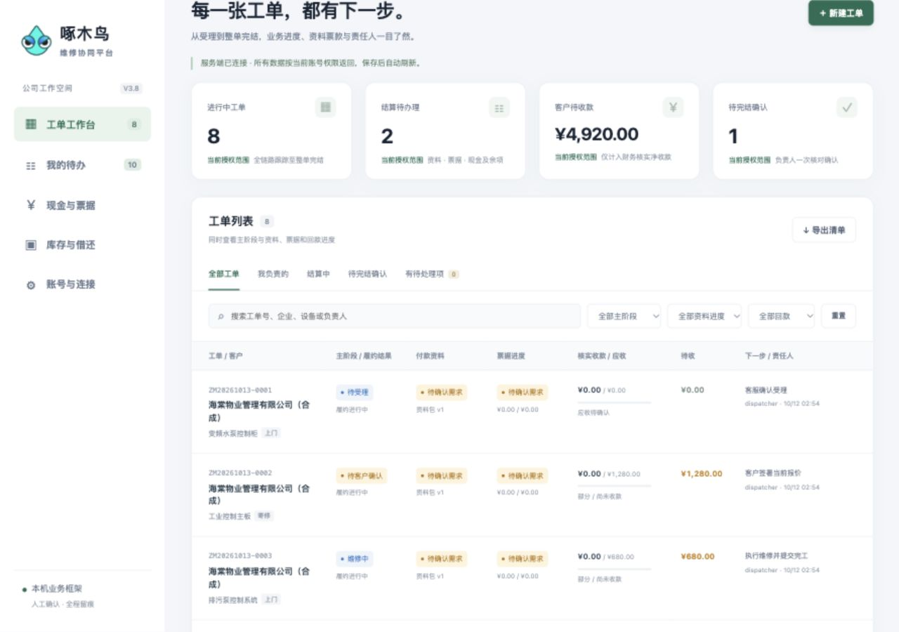

# 啄木鸟维修平台 V3.8 回归与优化报告


[toc]

---

## 🔥 <span id="前言">前言</span>

**结论：现有自动化测试通过，工作台可以继续用于合成样例演示；真实资料内测仍需补齐授权恢复、职责字段隔离和审计留痕。** 本轮确认 8 项问题或运行限制，按下文列出复现证据、修改建议和验收条件，没有修改业务源码。

**后续修复：** 用户已授权依据本报告修复，2026-10-14 的改动及重新验证见桌面项目 [修复说明](../../../../Desktop/啄木鸟维修平台-V3.8/docs/修复说明-2026-10-14.md)；后续代码定位见 [代码地图](../../../../Desktop/啄木鸟维修平台-V3.8/代码地图.md)。本文保留修复前发现及证据，最新状态以修复说明为准。

**最新二次回归：** 仍有 8 项新增发现及 1 项再次复现的旧并发问题，尚未修复；最新依据为 [二次回归分析与测试报告](./二次回归分析与测试报告-V3.8-2026-10-14.md)，首次修复通过记录仅作历史基线。

报告日期：2026 年 10 月 14 日，按用户客户端日期记录。回归对象为桌面目录 `啄木鸟维修平台-V3.8`；本报告保存于当前聊天工作目录，即本需求文件夹。原始日志保留工具产生的时间，证据目录沿用任务开始时的名称。

需求基线为 [V3.8 PRD](./物业设备维修服务平台%20PRD%20V3.8（Jobs规范版）.md)。对照了桌面项目的 [实现范围](../../../../Desktop/啄木鸟维修平台-V3.8/docs/实现范围.md)、[接口合同](../../../../Desktop/啄木鸟维修平台-V3.8/docs/workbench-contract.md) 和 [部署文档](../../../../Desktop/啄木鸟维修平台-V3.8/部署文档.md)。没有把演示框架的通过结果视为 PRD 全量验收，也没有依据本轮发现断言问题由最近一次修改引入。

[测试结果](#results) · [问题清单](#findings) · [需求覆盖](#coverage) · [优化顺序](#roadmap) · [证据与复现](#evidence)

## 一、<span id="scope">范围与执行边界</span> <a href="#前言" style="font-size:17px; color:green;"><b>🔼</b></a> <a href="#🔚" style="font-size:17px; color:green;"><b>🔽</b></a>

| 项目 | 本轮实际执行 |
| --- | --- |
| 后端 | [**Go**](https://go.dev/) 全包测试、竞态检测、静态检查；V3.8 授权、审计、加密恢复及容量边界诊断 |
| 数据库 | 专属临时 [**TiDB**](https://docs.pingcap.com/tidb/stable/) 实例，映射回环端口 `14038`；同时运行旧基线和 V3.8 集成测试 |
| 网页 | `Web`、`WebAdmin`、`Workspace` 现有 [**Node.js**](https://nodejs.org/) 测试；补充真实 `app.js` 函数的异常响应诊断 |
| HTTP | 项目已有独立合成样例冒烟脚本，覆盖登录、销售、签署、票款、借还、撤权等 6 组合同 |
| 浏览器 | 独立回环服务 `18038`；登录、角色切换、客户归属范围、筛选空态、断线回退；检查 `1280×900` 与 `390×844` 布局 |
| 构建 | macOS ARM64 本机构建；Linux AMD64、Windows AMD64 交叉编译 |
| 部署说明 | 核对入口、默认端口、跨域约束、恢复限制与实际代码是否一致 |

所有补充写操作、备份及恢复都使用临时目录和合成账号。没有读取桌面项目既有 `.runtime` 业务快照，没有访问现有数据库容器，没有调用真实支付、电子签、短信或其它付费渠道。

测试容器 `jobs-v38-regression-20261013-2001` 和浏览器测试服务已停止，临时浏览器标签已关闭、视口覆盖已恢复。原有 `repair-marketplace-api-1`、`repair-marketplace-tidb-1` 容器保留。没有创建提交或推送。

受检的 `Server`、`Workspace`、`Scripts` 共 104 个文件在补充审阅前后哈希一致，详见 [源码核验结果](./回归证据-V3.8-2026-10-13/source-verification.json)。这项核验只覆盖列入 [清单](./回归证据-V3.8-2026-10-13/source-sha256.json) 的文件。

## 二、<span id="results">测试结果与可用能力</span> <a href="#前言" style="font-size:17px; color:green;"><b>🔼</b></a> <a href="#🔚" style="font-size:17px; color:green;"><b>🔽</b></a>

### 2.1、<span id="automated">自动化与构建结果</span> <a href="#前言" style="font-size:17px; color:green;"><b>🔼</b></a> <a href="#🔚" style="font-size:17px; color:green;"><b>🔽</b></a>

| 检查 | 结果 | 证据与解释 |
| --- | --- | --- |
| 首轮全包 `go test -race` | 46 条通过、11 条跳过、0 失败 | [初轮日志](./回归证据-V3.8-2026-10-13/go-tests.jsonl)；跳过项均依赖显式测试数据库配置 |
| 专属 TiDB 下重跑全包 `go test -race` | **57 条通过、0 测试跳过、0 失败** | [完整日志](./回归证据-V3.8-2026-10-13/go-tidb-full.jsonl)；48 个根测试、9 个子测试结果，父子结果不代表 57 个独立业务场景 |
| V3.8 TiDB 专项 | 2 项通过 | [专项日志](./回归证据-V3.8-2026-10-13/tidb-tests.jsonl)；含加密快照／CAS／重启与不安全 TLS 配置拒绝，已包含在后续全包结果中 |
| `go vet ./...` | 退出 0，无诊断 | [日志](./回归证据-V3.8-2026-10-13/go-vet.log)为空属于正常结果 |
| 三套网页现有测试 | **34 项通过、0 失败** | [网页日志](./回归证据-V3.8-2026-10-13/web-tests.log)；其中 8 项是 `Workspace/data.js` 测试，其余 26 项属于旧网页基线 |
| V3.8 HTTP 冒烟 | **6 组通过** | [冒烟日志](./回归证据-V3.8-2026-10-13/http-smoke.log) |
| 补充 Go 诊断 | 7 项均成功复现预期观察 | [诊断日志](./回归证据-V3.8-2026-10-13/supplemental-go.jsonl)；其中包含已知错误行为的断言，**不能称为缺陷修复通过** |
| 补充网页诊断 | 异常响应误报成功已复现；403 拒绝对照正常 | [诊断日志](./回归证据-V3.8-2026-10-13/frontend-diagnostics.log) |
| 本机与交叉编译 | 3 个目标构建成功 | [本机日志](./回归证据-V3.8-2026-10-13/native-build.log)、[环境及产物摘要](./回归证据-V3.8-2026-10-13/environment.json)；Windows／Linux 二进制没有在对应系统运行 |

本机环境记录为 macOS ARM64、Go `1.27.2`、Node.js `26.11.1`。临时数据库使用本机已有 `pingcap/tidb:v8.5.8` 镜像；版本记录只描述本轮环境。

### 2.2、<span id="passed-contracts">已通过的核心合同</span> <a href="#前言" style="font-size:17px; color:green;"><b>🔼</b></a> <a href="#🔚" style="font-size:17px; color:green;"><b>🔽</b></a>

- 寄修整单流程可以从受理持续办理到人工完结；发货不冒充客户签收，验收签署独立于报价签署。
- 拒绝空白签名、管理员代客户签署、过期未签报价、错误报价版本；已有效签署的报价不因后来到期而自动失去履约资格。
- 收款登记、财务核实、内部交接保持不同事实；未核实现金不抵扣待收，交接不重复累计收入。
- 发票金额与附件要求、证据删除后的引用缺项、失败单退款退件门槛有自动化覆盖。
- 借还、隔离退回、耗用、处置数量守恒；并发借用、旧版本和同键重试受到保护，保存失败不提交半套业务变化。
- 跨企业访问、原件鉴权、联系人在线交接撤权、停用及重新启用后旧会话失效正常；恢复场景的例外见 [R01](#r01)。
- 自然月质保及自动验收日期边界、停机后的异议待复核机制有覆盖；加密快照重启、篡改拒绝、独占写锁与 TiDB revision 冲突检查通过。

这些结论限于日志里的受控场景，没有覆盖每个动作的全部角色、阶段和组合边界。

### 2.3、<span id="browser">浏览器观察</span> <a href="#前言" style="font-size:17px; color:green;"><b>🔼</b></a> <a href="#🔚" style="font-size:17px; color:green;"><b>🔽</b></a>

独立服务首次进入显示合成演示；调度账号登录后变为“服务端数据”，加载 8 单。切换客户账号后显示本企业归属的 7 单，没有公司 B 的 `ZM20261013-0008`。搜索不存在的内容显示完整空态和“重新加载”按钮，重置后恢复列表。

停止测试服务后，刷新显示明确断线提示并切换到 6 单独立样例，不沿用先前服务端列表。该观察验证了读取回退；本轮浏览器没有完成真实表单、文件上传或手绘签署的端到端故障测试。

桌面布局与手机宽度下的工单卡片、导航入口可以显示和操作，没有在已检查视图中发现阻塞。没有覆盖全部弹窗、键盘、触屏手势或其它浏览器内核。

| 截图／状态 | 文件 |
| --- | --- |
| 桌面工单列表 | [截图](./回归证据-V3.8-2026-10-13/browser-desktop.png)、[可访问性状态](./回归证据-V3.8-2026-10-13/browser-desktop.ax.txt) |
| 手机宽度客户列表 | [截图](./回归证据-V3.8-2026-10-13/browser-mobile.png)、[客户范围状态](./回归证据-V3.8-2026-10-13/browser-customer.ax.txt) |
| 筛选空态 | [截图](./回归证据-V3.8-2026-10-13/browser-empty.png)、[状态](./回归证据-V3.8-2026-10-13/browser-empty.ax.txt) |
| 断线回退 | [截图](./回归证据-V3.8-2026-10-13/browser-offline.png)、[状态](./回归证据-V3.8-2026-10-13/browser-offline.ax.txt) |



## 三、<span id="findings">问题与优化清单</span> <a href="#前言" style="font-size:17px; color:green;"><b>🔼</b></a> <a href="#🔚" style="font-size:17px; color:green;"><b>🔽</b></a>

本报告的优先级用于安排后续工程工作：P1 表示真实资料内测前应处理的授权或追溯问题；P2 表示可靠性、部署一致性或持续运行优化。这不是 PRD 的功能优先级编号，也不是漏洞评级。本轮没有发现已测正常路径中的 P0 阻塞；未覆盖场景不能据此排除 P0。

| 编号 | 优先级 | 发现 | 性质 |
| --- | --- | --- | --- |
| [R01](#r01) | P1 | 旧备份恢复会复活工单级联系人与旧执行人权限 | 部署文档已有说明，本轮动态确认 |
| [R02](#r02) | P1 | 内部角色读取字段没有按职责细分，QC 可读成本与提成 | 动态观察＋PRD 权限缺口；需落实读取矩阵 |
| [R03](#r03) | P1 | 导出没有持久审计，与接口合同描述不符 | 动态复现＋代码核对 |
| [R04](#r04) | P1 | 账号停用／恢复的原因未持久保存 | 动态复现 |
| [R05](#r05) | P2 | 账号状态表单将 HTTP 200 的 `null`／空对象当成成功 | 故障注入复现 |
| [R06](#r06) | P2 | 自定义跨域地址被同源策略阻断；直接文件预览默认端口不一致 | HTTP 预检复现＋静态核对 |
| [R07](#r07) | P2 | 幂等归档达到 10,000 条后全部新写入被拒绝 | 已有演示保护上限，动态确认运行限制 |
| [R08](#r08) | P2 | 首屏全量工单与完整事件链，分页未减少前端读取规模 | 合成容量观察＋结构分析 |

### 3.1、<span id="r01">R01：恢复后工单级撤权复活</span> <a href="#前言" style="font-size:17px; color:green;"><b>🔼</b></a> <a href="#🔚" style="font-size:17px; color:green;"><b>🔽</b></a>

**复现**：先备份 `wo_quote`，再将客户交接给同企业 `customer-peer`，并把工程师改派为 `outsource`。最新状态中原客户、原工程师均不可见此单。隔离恢复旧备份后，原客户和原工程师重新可见，新经办人反而不可见。

**原因与影响**：[storage.go](../../../../Desktop/啄木鸟维修平台-V3.8/后端/Go服务端/internal/workbench/storage.go) 第 316 行 `mergeRestrictions` 合并当前账号信息和证据删除标记，却没有合并工单访问授权变化；[service.go](../../../../Desktop/啄木鸟维修平台-V3.8/后端/Go服务端/internal/workbench/service.go) 第 288 行按旧 `CustomerID`／`AssigneeID` 判断可见性。账号仍处于有效状态时，重新登录即恢复旧权限。现有部署文档已经提示此边界，说明正确，但 PRD A07／A49／A53 的要求仍未满足。

**建议**：将工单访问授权与撤销记录作为独立、带稳定资源 ID 和授权版本的恢复约束保存；恢复业务历史时同时重建当前有效授权，保留历史签署人。约束缺失或不完整时拒绝开放对应资源，不简单把全部最新业务覆盖到旧备份。

**验收**：备份后交接联系人、改派工程师、撤销外包，再恢复旧备份；旧账号对列表、详情、文件、导出及重试结果均不可访问，新经办人仅获得有效授权范围，历史签署快照保持一致。最新源丢失的情况还需独立约束清单和灾备路线。

证据：`TestAuditRestoreRevivesOrderLevelAuthorization`，见 [补充日志](./回归证据-V3.8-2026-10-13/supplemental-go.jsonl)。

### 3.2、<span id="r02">R02：内部财务字段读取范围过宽</span> <a href="#前言" style="font-size:17px; color:green;"><b>🔼</b></a> <a href="#🔚" style="font-size:17px; color:green;"><b>🔽</b></a>

**复现**：管理员为样例单登记成本和提成后，QC 无权执行财务审批，却可在服务端视图中读到完整 `costs`、`commissions` 及说明。此处确认的是字段实际可读，不能单凭“无写权限”推导“必无读权限”。

**原因与影响**：[service.go](../../../../Desktop/啄木鸟维修平台-V3.8/后端/Go服务端/internal/workbench/service.go) 第 550 行仅按内部／外部两组脱敏，QC、仓库、工程师等内部角色没有单独的成本／提成读取策略。工单字段会随详情和 bootstrap 返回。PRD A49 要求无职责内部成本访问被拒；当前缺少能落实这条要求的读取矩阵。

**建议**：明确角色、职责、本人参与范围和字段组的读取权限，在服务端统一过滤详情、列表、导出、事件摘要和附件。工程师本人报销事实与他人提成应分别处理；如业务明确授权某角色读取财务字段，则记录该授权依据。只隐藏网页按钮不足以处理此问题。

**验收**：按经确认的读取矩阵测试 QC、仓库、工程师、财务及外部角色；普通读取、导出、错误响应和历史事件均不得带出未授权财务正文，同时保留各角色必要业务字段。

证据：`TestAuditQCCanReadFinanceFields`，见 [补充日志](./回归证据-V3.8-2026-10-13/supplemental-go.jsonl)。

### 3.3、<span id="r03">R03：导出审计缺失，合同描述需同步</span> <a href="#前言" style="font-size:17px; color:green;"><b>🔼</b></a> <a href="#🔚" style="font-size:17px; color:green;"><b>🔽</b></a>

**复现**：调用授权导出得到 200，持久化保存次数增加 0，快照前后逐字节一致。检查处理器也没有独立的成功导出审计写入。导出字段过滤仍生效，本项针对追溯能力。

**原因与影响**：[http.go](../../../../Desktop/啄木鸟维修平台-V3.8/后端/Go服务端/internal/workbench/http.go) 第 210 行直接返回 `bootstrap`；[接口合同](../../../../Desktop/啄木鸟维修平台-V3.8/docs/workbench-contract.md) 第 48 行却描述“留导出事件”。无法持久查证操作者、资源范围、时间及结果，未满足 PRD 6.3／A49／A54 的审计要求。

**建议**：增加受限、持久的导出／下载审计，记录账号、资源范围、时间和结果，不写资料正文、Token 或签名内容；明确审计失败时的导出处理策略。同时同步接口合同与验收记录，避免把未实现的留痕写成现状。

**验收**：成功导出、越权导出及原件下载各有可查询记录；重启后仍可查，客户和普通业务人员不能覆盖审计，审计数据不包含敏感正文。

证据：`TestAuditExportDoesNotPersistAudit`，见 [补充日志](./回归证据-V3.8-2026-10-13/supplemental-go.jsonl)。

### 3.4、<span id="r04">R04：账号授权变更原因丢失</span> <a href="#前言" style="font-size:17px; color:green;"><b>🔼</b></a> <a href="#🔚" style="font-size:17px; color:green;"><b>🔽</b></a>

**复现**：提交带独特合成原因的停用请求，账号确实变为 `disabled`，但持久快照中找不到该原因。账号旧会话失效已有正常测试，不属于本项故障。

**原因与影响**：[http.go](../../../../Desktop/啄木鸟维修平台-V3.8/后端/Go服务端/internal/workbench/http.go) 第 233 行要求输入 `reason`，随后仅更新 `Status` 和 `AuthVersion`。幂等记录保存请求摘要与返回 Actor，不能替代含操作者、前后状态和原因的授权审计。界面要求填写的交接依据无法事后查询。

**建议**：把操作者、目标账号、原／新状态、授权版本、时间及原因作为账号审计保存，与状态变更一起可靠提交；查询入口限管理员或授权审计角色。

**验收**：停用、恢复、重复提交以及重启后均能查询正确历史；同键重试不重复记事件，审计持久化失败不显示变更成功。

证据：`TestAuditAccountChangeDiscardsReason`，见 [补充日志](./回归证据-V3.8-2026-10-13/supplemental-go.jsonl)。

### 3.5、<span id="r05">R05：异常成功响应导致账号表单误报</span> <a href="#前言" style="font-size:17px; color:green;"><b>🔼</b></a> <a href="#🔚" style="font-size:17px; color:green;"><b>🔽</b></a>

**复现**：对现有 `app.js` 请求和账号表单函数注入 HTTP 200、正文 `null` 或 `{}`；两种情况下都关闭表单并显示“账号状态已更新”。403 对照请求仍正常拒绝。本项是异常响应测试，正常后端当前不会主动返回这些响应。

**原因与影响**：[app.js](../../../../Desktop/啄木鸟维修平台-V3.8/前端/Web网页/维修工作台/app.js) 第 130 行只验证 JSON 能解析和 HTTP 状态；第 907 行账号状态表单未验证返回账号 ID、状态及授权版本。代理错误或服务回归可能让用户误以为停用已经生效。现有 Workspace 测试主要覆盖 `data.js`，没有覆盖这个真实表单流程。

**建议**：按接口分别验证成功响应结构和目标状态；异常 2xx 视为结果未知，保留输入并提示重新核对，不能显示“已更新”或把账号授权写入演示副本。把该场景纳入正式 `app.js` 交互测试。

**验收**：`null`、空对象、错误账号 ID、缺少或不匹配状态、坏 JSON、延迟正文与超时均不误报成功；合法响应再关闭表单，同键重试仍受保护。

证据：[复现脚本](./回归证据-V3.8-2026-10-13/frontend-diagnostics.cjs) 和 [输出](./回归证据-V3.8-2026-10-13/frontend-diagnostics.log)。

### 3.6、<span id="r06">R06：连接配置与浏览器策略不一致</span> <a href="#前言" style="font-size:17px; color:green;"><b>🔼</b></a> <a href="#🔚" style="font-size:17px; color:green;"><b>🔽</b></a>

**观察**：工作台可以保存其它 HTTP／HTTPS 服务地址，但业务服务给页面设置 `connect-src 'self'`。另一个端口已经属于不同源；API 的跨域 OPTIONS 预检返回 405，且没有允许 Origin 的响应头。即使保存地址成功，浏览器仍无法按该配置连接。

另有 [app.js](../../../../Desktop/啄木鸟维修平台-V3.8/前端/Web网页/维修工作台/app.js) 第 110 行把 `file://` 默认地址写成 `8380`，而 [main.go](../../../../Desktop/啄木鸟维修平台-V3.8/后端/Go服务端/cmd/workbench/main.go) 第 78 行默认监听 `8098`。本项不会阻断部署文档推荐的同源启动路线；直接文件页面还涉及跨域限制，只改端口不足以恢复完整联网能力。

**建议**：优先统一同源入口，并在连接页校验、说明当前支持的地址范围。若确需分离网页和 API，由部署配置提供可信 Origin 白名单及对应 CSP，不使用任意 Origin 放行；直接文件打开明确作为离线样例路径，推荐现有本地预览服务。

**验收**：默认同源启动正常；不支持的跨域地址在保存前得到准确提示，或在受控白名单下通过预检与实际登录；未列入白名单的源仍被拒绝。默认端口和文档一致。

证据：`TestAuditBrowserCrossOriginConfiguration`、[网页诊断日志](./回归证据-V3.8-2026-10-13/frontend-diagnostics.log)。本轮验证了响应头与预检，未在浏览器中完整操作跨域地址配置。

### 3.7、<span id="r07">R07：幂等归档耗尽会停止新写入</span> <a href="#前言" style="font-size:17px; color:green;"><b>🔼</b></a> <a href="#🔚" style="font-size:17px; color:green;"><b>🔽</b></a>

**复现**：将隔离状态中的幂等归档填至 10,000 条，再提交无关的新设置请求，得到 `request_archive_full`；变更没有提交。该结果是演示版主动保护措施，拒绝后保持事务原子性是正确行为。

**影响**：[service.go](../../../../Desktop/啄木鸟维修平台-V3.8/后端/Go服务端/internal/workbench/service.go) 第 233 行没有按操作类型区分容量；新收款、借还、账号停用等也受同一上限影响。现有实现没有可持续、可审计的归档维护路线，长期运行到上限只能拒绝新业务。手动删除请求键会引入现金或库存重复执行风险。

**建议**：建立幂等记录独立存储、容量监测和维护策略；财务／签署关键依据保留稳定业务关联，不能仅按时间无条件丢弃。演示阶段至少显示容量与接近上限的提示，并说明受控维护方法。

**验收**：接近阈值时提前可见；维护后旧现金、借还、签署重试不重复执行，新业务能够继续办理；恢复后幂等依据保持一致。

证据：`TestAuditIdempotencyArchiveBlocksAllNewWrites`，见 [补充日志](./回归证据-V3.8-2026-10-13/supplemental-go.jsonl)。

### 3.8、<span id="r08">R08：全量首屏与聚合持久化需要容量优化</span> <a href="#前言" style="font-size:17px; color:green;"><b>🔼</b></a> <a href="#🔚" style="font-size:17px; color:green;"><b>🔽</b></a>

**观察**：[app.js](../../../../Desktop/啄木鸟维修平台-V3.8/前端/Web网页/维修工作台/app.js) 第 964 行刷新始终读取 `/bootstrap`；[http.go](../../../../Desktop/啄木鸟维修平台-V3.8/后端/Go服务端/internal/workbench/http.go) 第 289 行返回全部可见完整工单，包含事件和签署字段。已有列表接口第 314 行先构造所有匹配工单视图，再分页，不能避免全量视图计算。每次写入还复制、序列化并保存整个状态，幂等记录保存历史返回对象。

对复制的合成待签报价单测量 bootstrap 构造和 JSON 序列化，结果如下：

| 合成工单数 | JSON 字节数 | 单次耗时 |
| --- | --- | --- |
| 10 | 25,120 | 3.074 ms |
| 100 | 238,150 | 31.111 ms |
| 1,000 | 2,369,350 | 305.464 ms |

测量运行在竞态检测环境，没有网络、浏览器渲染、真实大附件或并发负载，也没有反复采样。这是响应规模和结构的观察，不能作为吞吐量、p95 或生产性能结论。当前 8 单演示没有出现此类阻塞。

**建议**：bootstrap 只返回身份、字典、配置与受权限控制的概览；工单列表使用轻量分页 DTO，详情和事件按需读取，汇总通过独立接口保持完整筛选口径。随后将聚合快照逐步拆为关系表、独立媒体存储和幂等表，保留事务、版本校验和授权边界。

**验收**：增加到 1,000／10,000 条合成数据时，首屏响应量由页大小控制；列表不逐行加载完整事件和签名；搜索、分页、汇总、导出权限和现金库存一致性继续通过。响应时间及并发目标另与业务确认后开展重复采样压测。

证据：`TestAuditBootstrapGrowth`，见 [补充日志](./回归证据-V3.8-2026-10-13/supplemental-go.jsonl)；PRD A28 要求分页不逐行加载整条证据／事件链。

## 四、<span id="coverage">需求覆盖与现阶段缺口</span> <a href="#前言" style="font-size:17px; color:green;"><b>🔼</b></a> <a href="#🔚" style="font-size:17px; color:green;"><b>🔽</b></a>

| PRD 范围 | 本轮证据 | 判断 |
| --- | --- | --- |
| A02／A06／A12／A13／A26／A27／A32 | 后端合同、数据层网页测试及 HTTP 冒烟 | 受控核心路径通过，不能代替全部端侧及真实客户验收 |
| A07／A49／A53 撤权与恢复 | 在线交接、封停测试通过，恢复后工单权限复活 | 部分通过，需处理 R01、R02、R03、R04 |
| A18／A54 降级与空态 | 登录、筛选空态、断线独立样例及异常响应诊断 | 读取路径正常；账号表单异常 2xx 需处理 R05；敏感写入端到端覆盖不足 |
| A28 操作和查询效率 | 全量 bootstrap、分页实现及容量观察 | 演示可用，需处理 R08；尚无业务约定规模下的压测验收 |
| A30 整单与分批事实 | 实现范围明确采用单个完整范围 | 多设备、分批交付／验收和金额分摊仍属未交付能力 |
| A50～A53 安全与灾备 | 加密、写锁、TiDB CAS、同盘临时隔离恢复通过 | 可信 HTTPS、密钥轮换、独立介质灾备和实测 RPO／RTO 未完成 |
| 多端及渠道 | 本轮回归网页与本地后端 | 原生客户端、小程序、真实支付、IM、AI、地图、物流与电子签没有据此验收 |

桌面项目已经说明聚合快照、小规模单机和整单演示边界。销售型号／数量主要存在报价说明，尚未形成完整结构化报价明细及逐行库存校验；正式签署文件仍需完善可交付版式与资料包。以上属于业务模型和交付能力缺口，不应混入“本次新增回归故障”的数量。

部署文档对 `8098` 同源启动、`8099` 离线预览、原密钥与最新源恢复、TiDB 恢复限制写得较明确。需要继续保持这些真实限制，并在后续修复 R01、R06、R07 时同步更新文档与测试证据。

## 五、<span id="roadmap">建议的优化顺序</span> <a href="#前言" style="font-size:17px; color:green;"><b>🔼</b></a> <a href="#🔚" style="font-size:17px; color:green;"><b>🔽</b></a>

1、先处理 R01、R02：恢复授权与职责字段矩阵直接决定谁可以读取资料。为列表、详情、文件、导出、幂等重试和恢复建立同一套权限验收。

2、接着处理 R03、R04：补持久审计，并修正接口合同中未实现的表述；账号变更与审计原子提交，导出和下载有受限追溯。

3、处理 R05、R06：完善真实 `app.js` 交互测试、响应结构验证和连接页限制，覆盖 2xx 坏数据、超时、迟到响应、身份切换与受控跨域。

4、处理 R07、R08：容量监测、幂等归档、轻量分页和按需详情；随后用更大合成数据压测，再决定关系表及媒体拆分节奏。

5、按 PRD 继续补多设备／分批范围、报价明细、正式签署资料，以及可信加密链路和独立灾备；这些需要单独设计和验收，不能通过扩大演示样例数量替代。

另有一个低成本文案优化：[app.js](../../../../Desktop/啄木鸟维修平台-V3.8/前端/Web网页/维修工作台/app.js) 第 362／386 行“有待处理项”实际只筛未解决 `issues`，不计待收、票据缺项或退件义务。本轮列表有这些待办但该数字仍为 0。建议改为“有未解决异议”，或统一定义更广的待办理计数，减少用户误读；未将其计为额外确定缺陷。

## 六、<span id="evidence">证据、复现与验证边界</span> <a href="#前言" style="font-size:17px; color:green;"><b>🔼</b></a> <a href="#🔚" style="font-size:17px; color:green;"><b>🔽</b></a>

### 6.1、<span id="reproduce">复现诊断</span> <a href="#前言" style="font-size:17px; color:green;"><b>🔼</b></a> <a href="#🔚" style="font-size:17px; color:green;"><b>🔽</b></a>

补充 Go 诊断源码为 [audit_regression_test.go](./回归证据-V3.8-2026-10-13/audit_regression_test.go)，本轮只复制进临时 Server 后运行。原业务项目未增加这些诊断测试。

以下命令创建新的临时源码副本，运行诊断，不接触原业务存储：

```shell
cd '/Users/jobs/Desktop/啄木鸟维修平台-V3.8'
V38_AUDIT_DIR="$(mktemp -d -t jobs-v38-audit)"
cp -R './Server' "$V38_AUDIT_DIR/Server"
cp '/Users/jobs/Documents/Github/啄木鸟维修平台/需求/回归证据-V3.8-2026-10-13/audit_regression_test.go' \
  "$V38_AUDIT_DIR/Server/internal/workbench/audit_regression_test.go"
'./Tools/go/bin/go' -C "$V38_AUDIT_DIR/Server" test -race \
  ./internal/workbench -run 'TestAudit' -count=1 -v
node '/Users/jobs/Documents/Github/啄木鸟维修平台/需求/回归证据-V3.8-2026-10-13/frontend-diagnostics.cjs' \
  './Workspace/app.js'
```

诊断断言包含“当前错误行为仍存在”，因此当前通过说明已复现。修复之后应将这些观察转换成正确行为断言并纳入正式测试，再记录新的验证结果，不能要求旧诊断继续通过。

全包数据库测试使用显式的 `REPAIR_TEST_TIDB_DSN` 和 `WB_TEST_TIDB_DSN`，只允许专属临时回环数据库；测试会创建并删除验证库。不得将它们指向已有业务实例。原始全包命令和环境写入 [验证清单](./回归证据-V3.8-2026-10-13/verification-manifest.json)。

### 6.2、<span id="limits">未验证事项</span> <a href="#前言" style="font-size:17px; color:green;"><b>🔼</b></a> <a href="#🔚" style="font-size:17px; color:green;"><b>🔽</b></a>

- 没有进行公网或生产部署、真实资料导入、真实客户业务验收。
- 没有在 Windows／Linux 实机运行交叉编译产物，没有新做原生客户端或小程序构建。
- 没有独立磁盘／异地介质、整机损失、磁盘满、停电及密钥轮换的完整灾备演练，没有声称达到生产 RPO／RTO。
- 没有持续负载、全部业务动作组合、大体积媒体、多实例并发或完整自动化浏览器套件的覆盖。
- 并行审阅代理触发用量限制，没有形成独立审阅结论；本报告来自主任务的实际测试和人工代码核对。

本轮还排除了一个初步怀疑：新弹窗打开会清空 `formKeys`，因此不能把“相同内容的两个独立弹窗提交”直接报告为幂等键复用缺陷。对照记录见 [网页诊断日志](./回归证据-V3.8-2026-10-13/frontend-diagnostics.log)。

完整证据保存在 [回归证据目录](./回归证据-V3.8-2026-10-13/)，包含原始测试输出、复现源码、环境摘要、源码哈希和 UI 截图；不包含运行密钥、Bearer、真实业务资料或业务快照。

<a id="🔚" href="#前言" style="font-size:17px; color:green; font-weight:bold;">我是有底线的➤点我回到首页</a>
